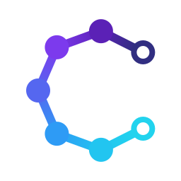

<p align="center">
  
</p>

# Catalyst

[](https://github.com/CajunSystems/catalyst/actions/workflows/ci.yml)

**A durable execution runtime for AI work on the JVM.** You write an AI task as plain Java. Catalyst
records every model call, tool call and side effect to an append-only log, so the task can:

- **survive a crash.** Kill the process mid-task, restart, and it continues from the exact step it
  reached, with **zero duplicate model calls**.
- **be replayed exactly.** Re-run a recorded execution with no external calls, and have Catalyst
  verify that your code still makes the same decisions.
- **be branched and diffed.** Fork a past run at any step, swap the model or a tool result, and
  compare the trajectories.
- **be inspected.** Timelines, token usage and cost are computed from the log, so there is nothing
  extra to instrument.

It runs embedded in your process. There's no server to operate; the durable log is a directory on
disk. Think *Temporal meets Git, for AI execution*.

> **Status:** pre-1.0, not yet published to a Maven repository; build it from source (below). The
> single-node runtime is complete and deployable. Multi-node failover on a FoundationDB-backed log
> works end to end and is new, so treat it as a preview (see [docs/deployment.md](docs/deployment.md)).
> See [ROADMAP.md](ROADMAP.md).

---

## Quickstart

**1. Build and install** (JDK 21 and Maven):

```bash
git clone https://github.com/CajunSystems/catalyst.git
cd catalyst
mvn install -DskipTests
```

**2. Add the dependency.** `catalyst-api` brings the runtime, the durable log, the built-in tools and
the observability exporters:

```xml
<dependency>
    <groupId>com.cajunsystems</groupId>
    <artifactId>catalyst-api</artifactId>
    <version>0.1.0-SNAPSHOT</version>
</dependency>
```

Catalyst's log library, Gumbo (`com.github.CajunSystems:gumbo`), comes from JitPack. Step 1 already
put it in your local Maven repository, which is enough on the same machine. Anywhere else, for
example your CI, add the repository:

```xml
<repositories>
    <repository>
        <id>jitpack.io</id>
        <url>https://jitpack.io</url>
    </repository>
</repositories>
```

**3. Write a task and run it:**

```java
import com.cajunsystems.catalyst.Context;
import com.cajunsystems.catalyst.ExecutionOptions;
import com.cajunsystems.catalyst.Task;
import com.cajunsystems.catalyst.api.Catalyst;
import com.cajunsystems.catalyst.engine.Timeline;
import com.cajunsystems.catalyst.mock.MockModel;
import com.cajunsystems.catalyst.model.CompletionRequest;
import com.cajunsystems.catalyst.model.Prompt;
import com.cajunsystems.catalyst.runtime.CatalystRuntime;
import com.cajunsystems.catalyst.runtime.ExecutionHandle;

import java.nio.file.Path;
import java.time.Instant;

public class Quickstart {

    /** A task is a unit of AI work. Anything that talks to the outside world goes through ctx. */
    static final class TriageTask implements Task<String> {
        @Override
        public String execute(Context ctx) {
            String summary = ctx.model().complete(CompletionRequest.of(Prompt.builder()
                    .system("You triage support tickets.")
                    .user("Summarize: the printer on floor 3 is offline")
                    .build())).message();
            String receivedAt = ctx.effect("received-at", () -> Instant.now().toString());
            return summary + " (received " + receivedAt + ")";
        }
    }

    public static void main(String[] args) {
        try (CatalystRuntime runtime = Catalyst.builder(Path.of("catalyst-data"))
                .model(MockModel.alwaysReturn("Printer offline, floor 3"))   // a real model: see below
                .task(new TriageTask())
                .recoverOnStart(true)
                .build()) {

            ExecutionHandle<String> run =
                    runtime.execute(new TriageTask(), ExecutionOptions.withKey("ticket-1042"));
            String result = run.result();
            Timeline timeline = runtime.inspect(run.id()).timelineView();
            System.out.println(result);
            System.out.println(timeline.modelCalls() + " model call(s), " + timeline.totalTokens() + " tokens");
        }
    }
}
```

```
Printer offline, floor 3 (received 2026-10-12T08:04:52.451055Z)
1 model call(s), 14 tokens
```

**Run it again.** You get the identical line, the same timestamp included, and the model is not
called. The key `ticket-1042` names an execution that already exists in `catalyst-data/`, so Catalyst
hands back its recorded result instead of running it again. If the first run had crashed halfway, the
second would have resumed from the last recorded step.

To use a real model, add `catalyst-langchain4j` and wrap any LangChain4j `ChatModel` (OpenAI,
Anthropic, Gemini, Ollama, …):

```java
.model(LangChain4jModel.of(OpenAiChatModel.builder().apiKey(key).modelName("gpt-4o").build()))
```

## See it survive a crash

The repo has runnable demos for every feature. This one records the first step of a two-step task,
kills its own process with the equivalent of `kill -9`, and then a second process finishes the job:

```bash
scripts/demo.sh /tmp/catalyst-demo record   # step 1 recorded, then the process dies (exit 137)
scripts/demo.sh /tmp/catalyst-demo resume   # a new process resumes it
```

```
[resume] result: SUMMARY|FINAL
[resume] model calls THIS run: 1 (step 1 was substituted from the log; only step 2 ran live)
```

Other demos: `scripts/demo.sh replay`, `branch`, `agent`, `eval`, `timer`, `child`, `supervise`, `fanout`, `signal`, `retry`, `cancel`, `shutdown`, `streaming`,
`timeline`, `otel`, `autocapture`, and more. The full list is at the top of `scripts/demo.sh`, and CI
runs every one of them as a gate.

## The ideas you need

- **Task:** your code, `Task<R>`, a unit of AI work. Make it a named class if it may be resumed by
  another process.
- **Context (`ctx`):** the only way a task touches the outside world: `ctx.model()`,
  `ctx.call(tool, input)`, `ctx.effect(label, supplier)`, `ctx.memory()`, `ctx.awaitSignal(name, type)`,
  `ctx.var(name)`. Each call is a **boundary**, and its result is recorded.
- **Execution:** one run of a task, with an `ExecutionId` and an event log. Give it an **idempotency
  key** (`ExecutionOptions.withKey(...)`) and resubmitting that key never runs the work twice.
- **Resume, replay, branch:** a task always re-runs from the top. Boundaries already in the log are
  **substituted** with their recorded results instead of executed, which is what makes all three work.
- **The one rule:** between boundaries, task code must be deterministic. Read the clock, generate ids
  and call external systems through `ctx`, or let the [auto-capture agent](docs/guide.md#auto-capture-nondeterminism-without-the-ceremony)
  rewrite the clock, random and UUID calls for you. A strict replay tells you if you broke the rule.

## Common tasks

| I want to… | Use | Details |
|---|---|---|
| call a real LLM | `LangChain4jModel.of(chatModel)` | [Models](docs/guide.md#models) |
| call an API or system with side effects | implement `Tool`, then `ctx.call(tool, input)` | [Tools](docs/guide.md#tools) |
| use the clock, random values or config safely | `ctx.effect("label", () -> …)` | [Effects](docs/guide.md#effects-memory-and-vars) |
| retry transient failures | `.retryPolicy(RetryPolicy.exponential(…))` | [Failures](docs/guide.md#failures-retries-and-in-doubt-calls) |
| decide what happens to a call cut off by a crash | `.inDoubtPolicy(…)` | [Failures](docs/guide.md#failures-retries-and-in-doubt-calls) |
| resume crashed work after a restart | `.task(...)` + `.recoverOnStart(true)` | [Resuming](docs/guide.md#idempotency-keys-and-resuming) |
| wait hours or days, then continue (durably) | `ctx.sleep(Duration.ofDays(3))` | [Timers](docs/guide.md#durable-timers) |
| hand work to a sub-task (a sub-agent) and wait for it | `ctx.child(new SubTask())` | [Children](docs/guide.md#child-executions) |
| run several sub-tasks at once, then collect them | `ctx.spawn(task)` + `ctx.awaitAll(handles)` / `awaitAny` | [Fan-out](docs/guide.md#fan-out-several-children-at-once) |
| restart a sub-task that fails | `ctx.child(task, Supervision.restart(3).backoff(d))` | [Supervision](docs/guide.md#supervising-a-child) |
| wait for a human's approval, then continue | `ctx.awaitSignal(name, type)` + `runtime.signal(id, name, payload)` | [Signals](docs/guide.md#signals-waiting-for-a-human) |
| cancel or pause an execution | `runtime.cancel(id)`, `pause(id)`, `resume(id)` | [Control](docs/guide.md#cancel-pause-resume) |
| check that my task code is deterministic | `runtime.replay(id, task)` | [Replay](docs/guide.md#inspect-replay-branch) |
| try a different model on a past run | `runtime.branch(id, seq).withModel(m).run(task)` | [Branch](docs/guide.md#inspect-replay-branch) |
| build a tool-calling agent that survives crashes and replays | `Agent.builder().tool(...).build().run(ctx, input)` | [Agents](docs/guide.md#agents) |
| give an agent the tools of an MCP server | `McpToolset.from(client).addTo(Agent.builder())` | [MCP](docs/guide.md#tools-from-an-mcp-server) |
| check a model or prompt change against real traffic | `Eval.on(runtime).cases(ids).candidate(...).run()` | [Evaluating](docs/guide.md#evaluating-models-and-prompts) |
| stream tokens to a UI | `ctx.model().stream(request, sink)` | [Streaming](docs/guide.md#streaming-completions) |
| see what an execution did, and what it cost | `TimelineReport.writeTo(...)`, `CatalystTracer` (OTel) | [Observability](docs/guide.md#timeline-reports-and-opentelemetry) |

## Running in production

[docs/deployment.md](docs/deployment.md) covers:
- running a node on a persistent volume (and why not a shared filesystem)
- recovery on startup, graceful shutdown and drain timeouts
- choosing failure policies, and backups
- scaling out by sharding on idempotency key

## Modules

Most applications need only `catalyst-api`, plus `catalyst-langchain4j` for real models and
`catalyst-mcp` for MCP tools.

| Module | What it is |
|---|---|
| `catalyst-api` | The `Catalyst` entry point; depends on everything below except `catalyst-langchain4j` |
| `catalyst-core` | `Task`, `Context`, the `Model`/`Tool`/`Memory`/`EventLog` interfaces, and the record/replay engine |
| `catalyst-runtime` | `CatalystRuntime`: scheduling, lifecycle, idempotency, recovery, shutdown; in-memory log |
| `catalyst-gumbo` | The durable, file-backed log, built on [Gumbo](https://github.com/CajunSystems/gumbo) |
| `catalyst-events` | The event schema and its serialization (kept stable; changes are additive) |
| `catalyst-tools` | Built-in tools: clock, calculator, HTTP, sandboxed filesystem |
| `catalyst-langchain4j` | Adapter for any LangChain4j chat model, streaming included |
| `catalyst-mcp` | An MCP server's tools as Catalyst tools, for agents (official MCP Java SDK; opt-in) |
| `catalyst-timeline` | Renders an execution as a self-contained HTML report |
| `catalyst-otel` | Exports an execution as an OpenTelemetry trace (API only; you bring the SDK) |
| `catalyst-eval` | Eval harness: replays recorded runs against candidate models and prompts, and scores them |
| `catalyst-agents` | A tool-calling agent loop built on `Task` (not to be confused with `catalyst-agent`, the auto-capture javaagent) |
| `catalyst-agent` | Optional Java agent that records clock, random and UUID calls automatically |

Java package root: `com.cajunsystems.catalyst`.

## Building and testing

```bash
mvn install                          # everything, with tests
mvn -pl catalyst-core -am install    # one module and what it depends on
```

The acceptance tests in `catalyst-api` (`*AcceptanceTest`) are each feature's end-to-end proof, and
each has a matching `scripts/demo.sh` demo that CI runs. On **macOS**, `FilesystemToolTest`,
`ToolsAcceptanceTest` and `TimelineAcceptanceTest` fail by design: `FilesystemTool` refuses to run
without the JDK's `SecureDirectoryStream`, which macOS lacks. They pass on Linux and in CI.

Working on Catalyst itself? [CLAUDE.md](CLAUDE.md) is the contributor's map: architecture, the
invariants the engine must keep, and the reasoning behind each feature.

## Documentation

- [Developer guide](docs/guide.md): writing tasks, models and tools, failures, replay and branch,
  streaming, observability, auto-capture, how the log works
- [Deployment](docs/deployment.md): running and scaling Catalyst as a service
- [Roadmap](ROADMAP.md): what's done and what's next
- [Schema evolution](docs/schema-evolution.md) and [Distribution design](docs/distribution.md)

## License

MIT; see [LICENSE](LICENSE).
